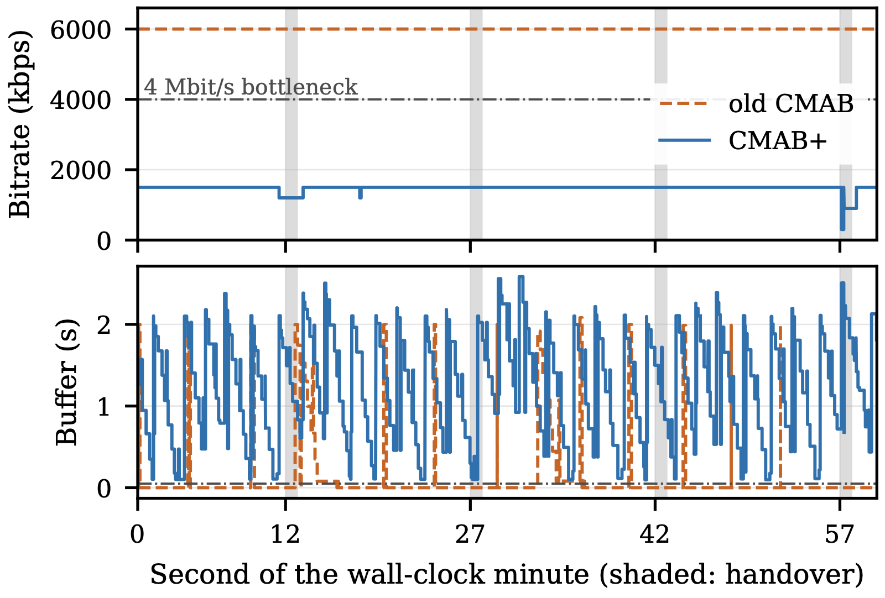

# Part 3. Review III: forced-rung collapse and CMAB+

[Back to the index](../GROUND_UP_GUIDE.md) · Previous: [Part 2](02-review2.md) · Next: [Part 4, every experiment](04-experiments.md)

From here on, "old CMAB" means the paper's controller as shipped in the artifact, and "CMAB+" means our version.

---

## 3.1 From a hint to a diagnosis

D2 showed that, on the same trace, Dynamic adapted down to 619 kbps while CMAB kept requesting about 5800 kbps. So we read the two files that implement CMAB in dash.js: `CMABAbrController.js` (the decision logic) and `CMABRule.js` (which wraps the decision as a dash.js rule).

The code gave a direct explanation:

1. After each 15-second slot boundary, while fewer than |A| − 1 = 7 decisions have been made in the slot, the controller returns the top arm (6000 kbps). It does not call LinTS and does not look at the throughput estimate.
2. The rule sends every switch at STRONG priority. In dash.js a STRONG request beats every DEFAULT request, including the throughput rule that would normally lower the rung (Part 0.5).

The original lines, as cited in our Review II notes:

```javascript
// just recovered from satellite handover
if (_selectedArmsArray.length < cmabArms.length - 1) {
    selectedArm = cmabArms.length - 1      // always the top arm
} else {
    selectedArm = pyodide.runPython(_py_mabwiser_select_arm);   // LinTS
}
...
switchRequest.priority = SwitchRequest.PRIORITY.STRONG;
```

Neither the forced window nor the STRONG priority appears in the paper's equations. The paper describes LinTS; the code adds a start-up rule around it.

## 3.2 Two pieces of arithmetic

Decisions per slot. A slot is 15 s and a segment is 2 s. In live streaming the player cannot run ahead of the live edge, so a player keeping pace makes about one decision per 2 s, which is about 7 or 8 decisions per slot. The forced window is 7 decisions. So the forced window covers almost the whole slot, every slot, four times a minute.

Download time of the top rung. One 6000 kbps segment of 2 s carries 12 Mbit. Over a 4 Mbit/s link that takes at least 12 / 4 = 3 s to download, which is longer than the 2 s it plays.

Put together: on a link slower than 6 Mbit/s, every forced decision downloads slower than it plays, so the buffer drains. A stalled player downloads fewer segments, so it makes fewer decisions per slot, so it may never reach decision 8 where LinTS would take over. Then the next slot boundary resets the count and the forced window starts again. We call this forced-rung collapse.

## 3.3 A worked timeline of the collapse

The following is a simplified, idealized calculation, not a measured trace. It assumes the link delivers its full 4 Mbit/s, with no TCP overhead, no handover loss and normal playback speed. Real TCP delivers less, so real sessions are worse than this.

Setting: 4 Mbit/s link, old CMAB, the slot starts at second 12, the buffer holds 2.0 s.

| Time (s) | Event | Buffer |
| --- | --- | --- |
| 12.0 | Slot starts. Decision 1 is forced: 6000 kbps (12 Mbit, needs 3.0 s) | 2.0 s |
| 14.0 | Buffer empty; picture freezes | 0.0 s |
| 15.0 | Segment arrives (+2 s of video). Decision 2 is forced: 6000 kbps | 2.0 s |
| 17.0 | Buffer empty; frozen again | 0.0 s |
| 18.0 | Segment arrives. Decision 3 forced | 2.0 s |
| 21.0 | Decision 4 forced, after another 1 s stall | 2.0 s |
| 24.0 | Decision 5 forced, after another 1 s stall | 2.0 s |
| 27.0 | Handover. New slot. Counter resets to 0. LinTS never ran | |

Even in this best case:

- Each 3-second cycle has 2 s of playing and 1 s frozen.
- The slot holds only 5 decisions, fewer than the 7 forced ones, so the bandit never gets to choose.
- Each frozen second adds a second of live latency, and the catch-up controller then speeds playback up to recover, which drains the buffer faster.

In the measured 4 Mbit/s runs, old CMAB at a 3 s target averaged 8.58 s latency and 82.25% rebuffering under CUBIC (Part 4).

Compare the same forced window on the paper's 100 Mbit/s clock shaper: a 12 Mbit segment downloads in about 0.12 s (0.24 s at the 50 Mbit/s handover rate). The buffer fills easily, so forcing the top rung costs nothing. That is why Review I and D3 looked healthy and why the paper's emulation could not expose the problem.

On the trace shaper, the ceiling is 50 Mbit/s, but the long RTT and the 100% loss rows hold TCP far below that, often below 6 Mbit/s, so collapse appears there too. That matches D2.

## 3.4 What the timeline figure shows



Report Figure 2: one minute of one session per player on the 4 Mbit/s capacity shaper (CUBIC, 3 s target, round 0), taken from the first full minute after 120 s of playback. Grey bars mark the handover seconds 12, 27, 42 and 57.

- Top panel, requested bitrate. Old CMAB (orange dashed) sits at 6000 kbps for the whole minute, above the 4 Mbit/s line. CMAB+ (blue) holds 1500 kbps, with short drops: to 1200 kbps near second 12, and to about 300 then 900 kbps near second 57, after which it climbs back.
- Bottom panel, buffer. Old CMAB's buffer lies on the floor (the dashed line is the 0.05 s rebuffer threshold) with brief spikes when a segment arrives. CMAB+ keeps its buffer between about 0.5 and 2.5 s.

## 3.5 The search for a fix: eight trials

We kept the paper's learner and changed only the logic around it. The trials ran mostly on the clock shaper, under BBR first and then CUBIC. Unhardened old CMAB on the same clock shaper was 3.19 s / 0% / 4955 kbps (CUBIC) and 3.29 s / 0% / 5223 kbps (BBR). Results are at the 3 s target.

| Trial | Change | Run | Result at 3 s | Verdict |
| --- | --- | --- | --- | --- |
| 1 | Remove the top-rung probe, no replacement | BBR clock, 160 sessions | 900 kbps at every target | Rejected |
| 2 | Probe the highest feasible rung, clamp LinTS to it | BBR clock, 160 sessions | 4.99 s / 1.0% / 5200–5400 kbps | Probe and clamp kept; latency problem left |
| 3 | Step down while latency is above target | BBR, stopped at 26 sessions | 3.17 s / 0% / 300 kbps | Rejected |
| 4 | Step down only when more than 1 s late | BBR clock, 160 sessions | 3.32 s / 0% / 4894 kbps | Looked fine on BBR |
| 4 | Same, on CUBIC | CUBIC, stopped at 7 sessions | 3.98 s / 0% / 3035 kbps | Failed on CUBIC |
| 5 | Trial 4 plus climb at most one rung | CUBIC clock, 160 sessions | 3.85 s / 0.04% / 2626 kbps | Rejected |
| 6 | Trial 4 plus graded climb | CUBIC, stopped early | 5.18 s / 0.56% / 708 kbps | Rejected |
| 7 | Trial 4, final full run | CUBIC clock, 160 sessions | 4.02 s / 0% / 3009 kbps | Rejected: latency as trigger dropped |
| 8 | Step down when the playing rung exceeds throughput | Capacity shaper, 90 sessions | See Part 4 | Kept: the core of CMAB+ |

What each trial taught us, in order:

Trial 1, no probe at all (prefix `1027-0300`). We simply deleted the forced top-rung window. CMAB then sat at 900 kbps at every target while the other ABRs played 5000–6000 kbps. Latency was on target and rebuffering about 0%, but LinTS never left the low arms. Lesson: the bandit needs some upward probe after its memory is wiped, or it never tries the high rungs.

Trial 2, feasible probe and clamp (prefix `1027-2225`). In the same window, request the highest rung at or below the safe throughput estimate, and cap later LinTS choices the same way. In this trial, a clamped switch or a buffer under 0.5 s used normal priority instead of STRONG. Bitrate recovered to about 5200–5400 kbps, but latency at a 3 s target was 4.99 s, against 3.12 s for L2A-LL in the same run. Our notes record about 147 switches per session and a buffer under 0.5 s in 16% of samples. Lesson: probe and clamp fix the bitrate; something was still keeping the player late.

Trial 3, step down whenever late. While live latency was above the target, the rung could not rise and stepped down one rung per decision. Latency landed on target (3.17 s), but bitrate fell to 300 kbps, the bottom rung. The reason: a healthy player always runs a little above its target (L2A-LL sits at 3.12 s for a 3 s target), so "latency above target" was almost always true and the ladder walked all the way down. Lesson: a zero-margin latency trigger fires on normal operation.

Trial 4, step down only when more than 1 s late (prefix `1030-0137`). On BBR this looked good: 3.32 s, 0%, 4894 kbps at 3 s, with 4.21–6.23 s at the other targets. Then a CUBIC check (prefix `1031-0032`, 7 sessions) gave 3.98 s and only 3035 kbps. The 1 s line for a 3 s target is 4.0 s, and the player sat right on it: below the line the probe jumped to the highest feasible rung, which pushed latency back over the line, which forced a step down.

Trials 5 and 6, gentler climbing. Trial 5 (prefix `1031-2231`) allowed at most one rung up per decision: 3.85 s, 2626 kbps, worse than old CMAB at 3 s. Trial 6 took the full climb only at or below the target and half the gap between target and target + 1 s; because latency started around 5 s, the full-climb branch never fired, and it gave 5.18 s and 708 kbps.

Trial 7, final run of trial 4 on CUBIC (prefix `1102-1304`, 160 sessions, archived). 4.02 s at a 3 s target, against the 4.0 s line, with 3009 kbps on a link where old CMAB carried 4955 kbps. The same-run L2A-LL reached 5550 kbps at 4.06 s. Lesson: live latency is the wrong trigger for stepping down, because it cuts bitrate on links that can carry the current rung.

Trial 8, throughput as the trigger (commit `c9af3e6`, runner fixes through `c2a8db2`). Keep the feasible probe and the clamp. Step down only when the rung already playing is faster than the measured safe throughput. Latency by itself no longer triggers anything. We tested this on a new capacity shaper (8, 4, 1 Mbit/s) with old CMAB, CMAB+ and L2A-LL in the same batch. At 4 Mbit/s it removed the collapse under both transports. This became the core of CMAB+.

After trial 8, rule 5 came from trace runs. Without it, CMAB+ still rebuffered 30.84–35.22% on the trace under CUBIC. We added a stall guard. Two variants of the guard were tried and dropped as flat or worse: one that kept a spare rung below the throughput estimate, and one that forced the bottom rung. A comment in the policy code records that an early version left the guard after only three healthy decisions, which let the player climb back between Starlink loss spikes; the final guard waits 12.

## 3.6 CMAB+: the five rules

CMAB+ keeps LinTS, the context vector, the reward, the 15-second slot reset and the catch-up policy exactly as in the paper. It changes only what happens around the bandit's choice.

Notation (from the report):

- r_i is the bitrate of arm i, from r_0 = 300 kbps up to r_7 = 6000 kbps.
- T̂ is the safe throughput estimate from `getSafeAverageThroughput`, already multiplied by 0.9.
- q is the quality (arm) currently playing.
- i* is the highest feasible arm: the largest i with r_i ≤ T̂. If T̂ is missing, i* = 0.

### Rule 1: feasible probe

Analogy: after the road changes, test-drive the biggest truck that fits under the bridge you just measured, not the biggest truck you own.

Mechanism: in the first |A| − 1 = 7 decisions of a slot, request i* instead of the top arm. LinTS is skipped in this window, as in old CMAB, so the learner's state stays aligned with the paper's bootstrap. The bandit still gets fresh data at a high rung, but only at a rung the link has shown it can carry.

On a 4 Mbit/s link, T̂ is below 4900 kbps, so i* is the 1500 kbps rung. Old CMAB would force 6000 kbps.

### Rule 2: throughput clamp

Analogy: the learner may suggest any truck, but a height bar at the depot stops anything taller than the bridge.

Mechanism: after the window, the LinTS arm is capped at i*: applied arm = min(LinTS arm, i*). The bandit still chooses freely among feasible rungs.

### Rule 3: throughput-triggered step-down

Analogy: if the truck already on the road is too tall for the bridge, the next trip uses one size smaller, and there is no upgrade on this trip.

Mechanism: if r_q > T̂, the bitrate now playing is faster than the link is delivering. Then the arm cannot rise on this decision and is at most q − 1. Otherwise the clamped suggestion stands, including a jump up to i*. Live latency does not enter this rule. Trials 3 to 7 showed why: latency is a little above target in normal operation, so a latency trigger cuts bitrate on links that can carry the current rung.

### Rule 4: switch priority

Analogy: an upgrade that the height bar had to trim is sent as ordinary advice, so the other advisors can still veto it. Downgrades and untrimmed choices stay as orders.

Mechanism: an upward switch that rule 2 reduced uses DEFAULT priority, so other dash.js rules may lower it further. All other switches keep STRONG. Downward switches stay STRONG so that a player in trouble can leave a high rung quickly.

### Rule 5: stall guard

Analogy: after skidding on ice, drive at the speed that was safe on the worst patch of the last eight stretches, and do not speed up until you have driven twelve stretches in a row on dry road.

Mechanism:

- It turns on when a real quality is playing (not start-up) and the buffer is at or below 0.05 s, the same threshold as the rebuffer metric.
- While on, the arm cannot rise above q, and it is capped at the highest rung that fits the worst of the last eight segment throughputs, scaled by the same 0.9 safety factor.
- It turns off after 12 consecutive decisions with at least 1 s of buffer. A decision with less than 1 s resets the count.
- It does not use live latency.

Why it exists: on the trace, a smoothed average throughput can look fine between loss spikes, so rules 1 to 3 let the player climb back just before the next spike. Using the worst recent sample and a long healthy run holds the player down through the bad stretch.

Cost: it is slower to recover than rule 3 alone, so it lowers bitrate on the trace (Part 4.6).

Why it should not hurt healthy links: on the paper clock and the flat 4 Mbit/s link, CMAB+ with rules 1 to 4 does not empty its buffer, so the guard should never turn on. Spot runs of the final player were recorded as unchanged there, but those session trees are not in the archives (Part 4.7).

## 3.7 One decision, step by step

The report's Algorithm 1, written as plain pseudocode:

```
input: ladder r_0 < ... < r_7, safe throughput T̂, playing quality q,
       buffer b, decisions n made in this slot, guard state g

i* = highest i with r_i <= T̂   (0 if T̂ is missing)

if n < 7:                     # rule 1 (old CMAB would use the top arm, 7)
    s = i*
else:
    s = LinTS.select()

a = min(s, i*)                # rule 2
clamped = (a != s)

if q >= 0 and r_q > T̂:        # rule 3
    a = min(a, max(0, q - 1))

g = UpdateGuard(g, b, q)      # on if b <= 0.05 s; off after 12 decisions with b >= 1 s
if g.active:                  # rule 5
    w = 0.9 × min(last 8 segment throughputs)
    a = min(a, q, highest i with r_i <= w)

priority = DEFAULT if (clamped and a > q) else STRONG   # rule 4
request arm a at that priority; record the reward; n = n + 1
```

At each slot boundary, n and the LinTS history are reset, as in the paper.

Example on a 4 Mbit/s link, mid-slot, decision 9. Say T̂ = 3400 kbps, q = 4 (1500 kbps playing), buffer 1.5 s, guard off, and LinTS suggests arm 7.

1. i* = 4 (1500 ≤ 3400 < 4900).
2. n ≥ 7, so s = 7 from LinTS.
3. a = min(7, 4) = 4; clamped = true.
4. r_q = 1500 is not above 3400, so rule 3 does nothing.
5. Guard is off.
6. a = 4 is not above q = 4, so this is not an upward switch: priority STRONG.
7. Request 1500 kbps. Old CMAB would have requested 6000 kbps at STRONG.

## 3.8 Where the code lives and how it is switched on

- Rules: `dash.js/src/streaming/rules/abr/cmab/cmabPlusPolicy.js`, a set of small pure functions (`maxFeasibleArm`, `applyFeasibilityClamp`, `applyLatencyStep`, `updateStallGuard`, `applyStallGuard`, `chooseSwitchPriority`, and others).
- Wiring: `CMABAbrController.js` calls them in the order above; `CMABRule.js` collects the worst of the last eight throughputs and scales it by the safety factor.
- Switch: the player setting `cmabHardened=true` turns the rules on for `abrCMAB` only. The other ABRs are untouched. In result folders, CMAB+ sessions carry the prefix `abrCMABPlus`.
- Tests: `experiments/test_cmab_plus_policy.mjs` unit-tests the rules without Docker.

Two naming notes. The function for rule 3 is still called `applyLatencyStep`, a leftover name from the latency-trigger trials; its trigger is throughput. And some Review III notes say "rules 1–3" for the clock and 4 Mbit/s runs; the report counts the priority rule separately and calls the same player "rules 1–4".

## 3.9 What CMAB+ is not

- It is not a new bandit algorithm. LinTS and the reward are the paper's.
- It does not step down because latency is high.
- It does not keep a spare margin below T̂. A rung just below the estimate is allowed. This is why, at 1 Mbit/s under CUBIC, it chose mostly the 900 kbps rung and stalled (Part 4.4).
- It does not change the reward to see stalls. That would change the learner, which we left alone on purpose.

---

[Back to the index](../GROUND_UP_GUIDE.md) · Previous: [Part 2](02-review2.md) · Next: [Part 4, every experiment](04-experiments.md)
