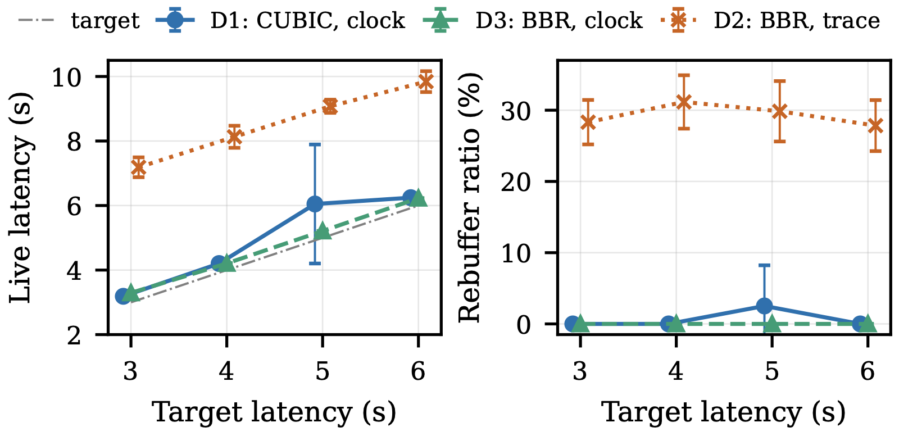
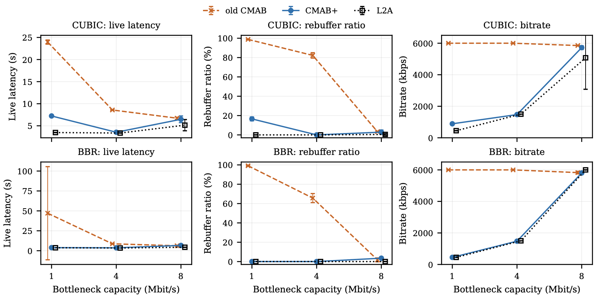
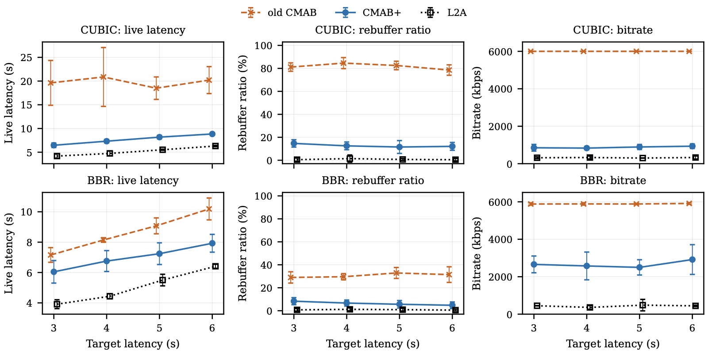

# Part 4. Every experiment, its numbers, and how to read the figures

[Back to the index](../GROUND_UP_GUIDE.md) · Previous: [Part 3](03-review3-cmabplus.md) · Next: [Part 5, comparison and limitations](05-comparison-limitations.md)

All numbers in this part come from the final report (`report/paper.tex`) and the CSV files under `report/results/` and `review-3/results/`. Latency is in seconds, rebuffer ratio in percent, bitrate in kbps. "Mean of 5" means the mean of five 300-second sessions.

---

## 4.1 The Review III plan at a glance

| Experiment | Shaper | Targets (s) | CMAB+ rules | Sessions | Real-life situation it stands for |
| --- | --- | --- | --- | ---: | --- |
| Non-regression | Paper clock (100 Mbit/s) | 3, 4, 5, 6 | 1–4 | 120 | A healthy dish with plenty of capacity, like the paper's emulator |
| Capacity | Capacity clock at 8, 4, 1 Mbit/s | 3 | 1–4 | 90 | A dish whose usable rate is low: a busy shared terminal, a congested cell, a cheap plan |
| 4 Mbit/s targets | Capacity clock at 4 Mbit/s | 3, 4, 5, 6 | 1–4 | 120 | The same slow link, for services that choose different latency targets |
| Trace validity | ISL trace | 3, 4, 5, 6 | 1–5 | 120 | A terminal whose traffic crosses laser ISLs, with long, variable RTT and handover outages |

Total: 450 sessions of 300 s, which is 37.5 hours of streamed video. Each cell has five rounds. Every batch ran old CMAB, CMAB+ and L2A-LL side by side, on the same VM and container stack as Review I. CUBIC and BBR runs were sequential, never at the same time.

Why L2A-LL is the reference: in Review I it held the target as tightly as Dynamic and played the top rung throughout, and in D2 it rebuffered least. We did not rerun Dynamic or LoL+ in Review III.

Code versions: the non-regression, capacity and 4 Mbit/s runs used rules 1–4 (commit `c9af3e6` plus runner fixes). The trace runs used the final player with the stall guard (commit `8d0596c`).

### Pass criteria, fixed before running

1. Paper clock: CMAB+ stays in the same class as old CMAB, meaning similar bitrate, near-zero rebuffering and latency within a few tenths of a second.
2. 4 Mbit/s: CMAB+ avoids collapse at every target.
3. Trace: CMAB+ rebuffers less than old CMAB without settling on the bottom rung as its only operating point.

Writing the gates down first matters: it stops anyone from moving the goalposts after seeing the data.

## 4.2 Figure A: CMAB across the Review I and II datasets

Report Figure 1. Left: CMAB's live latency against the latency target. Right: CMAB's rebuffer ratio. Mean of 10 sessions with 95% t intervals.

How to read it:

- The grey dash-dot line in the left panel is "latency equals target". A player on that line hits its target exactly.
- Blue circles (D1, CUBIC, clock) and green triangles (D3, BBR, clock) lie close to the line at every target and at 0% rebuffering. Under the clock shaper, the transport makes little difference.
- The tall blue error bar at 5 s is the single outlier round from Review I (Part 1.3). It lifts the D1 mean to 6.05 s and 2.52%.
- Orange crosses (D2, BBR, trace) sit 4 s or more above the line, with about 28–31% rebuffering at every target. That gap comes from the trace shaper, not from BBR.

## 4.3 Experiment 1: no regression on the paper clock

Why: a fix that breaks the healthy case is not a fix. The paper's own emulator carries every rung, so CMAB+ must behave like old CMAB there.

Setup: paper clock (100 Mbit/s; 50 Mbit/s, 100 ms, 1% loss in handover seconds), targets 3–6 s, CUBIC and BBR, five rounds, 120 sessions, rules 1–4.

Results (report Table 4, latency / bitrate):

| TCP | Target | old CMAB | CMAB+ | L2A-LL |
| --- | --- | --- | --- | --- |
| CUBIC | 3 s | 4.09 / 5363 | 4.24 / 5420 | 4.02 / 6000 |
| CUBIC | 4 s | 4.52 / 5292 | 4.54 / 5433 | 4.37 / 6000 |
| CUBIC | 5 s | 5.29 / 5430 | 5.24 / 5448 | 5.03 / 6000 |
| CUBIC | 6 s | 6.28 / 5378 | 6.27 / 5462 | 6.02 / 6000 |
| BBR | 3 s | 3.45 / 5251 | 3.44 / 5255 | 3.06 / 6000 |
| BBR | 4 s | 4.21 / 5252 | 4.23 / 5290 | 4.08 / 6000 |
| BBR | 5 s | 5.51 / 5201 | 5.23 / 5285 | 5.08 / 6000 |
| BBR | 6 s | 6.23 / 5340 | 6.31 / 5329 | 6.06 / 6000 |

Rebuffering is 0% in every cell except under BBR: old CMAB 0.26% at 5 s, CMAB+ 0.08% at 5 s and 0.38% at 6 s. All three intervals include zero.

What it means:

- CMAB+ is never more than 0.15 s slower than old CMAB (CUBIC, 3 s, where the two 95% intervals overlap: 4.09 ± 0.16 s and 4.24 ± 0.29 s).
- It is 0.28 s faster under BBR at 5 s.
- It plays 3 to 141 kbps more in seven of eight cells and 11 kbps less in the eighth (BBR, 6 s).
- L2A-LL plays 6000 kbps and is 0.15–0.38 s closer to the target than CMAB+.
- Pass: on a link that carries every rung, CMAB+ and old CMAB end up in the same operating range. This is expected from the design: when T̂ is far above 6000 kbps, i* is the top rung, so rules 1 and 2 change nothing.

A puzzle in this table: the CUBIC latencies are about 0.9 s higher than in Review I at the 3 s target (old CMAB 4.09 s here, 3.19 s in Review I), and L2A-LL moved from 3.00 to 4.02 s. Both players shifted together, so the cause lies in the testbed between the September and November runs, not in CMAB+. We have not isolated it. For this reason we compare players only within a batch, never across batches.

## 4.4 Experiment 2: capacity, where collapse appears

Why: Part 3 predicts collapse whenever the link cannot carry 6000 kbps. The capacity shaper tests that prediction directly while keeping the paper's handover pattern.

Setup: capacity clock at 8, 4 and 1 Mbit/s; 40 ms and 0.1% loss normally; 100 ms and 1% loss in the handover seconds; the rate stays at the set value during handovers. 3 s target, CUBIC and BBR, five rounds, 90 sessions.

The three rates were chosen on purpose:

- 8 Mbit/s is 1.33 times the 6000 kbps top rung, so the top rung nominally fits but with little room.
- 4 Mbit/s falls in the gap between the 1500 and 4900 kbps rungs, so the top three rungs cannot fit.
- 1 Mbit/s fits only the three lowest rungs.

Results (report Table 5, latency / rebuffer / bitrate):

| TCP | Capacity | old CMAB | CMAB+ | L2A-LL |
| --- | --- | --- | --- | --- |
| CUBIC | 8 Mbit/s | 6.73 / 3.31 / 5854 | 6.48 / 2.85 / 5721 | 5.15 / 0.45 / 5075 |
| CUBIC | 4 Mbit/s | 8.58 / 82.25 / 6000 | 3.54 / 0 / 1473 | 3.36 / 0 / 1500 |
| CUBIC | 1 Mbit/s | 23.96 / 98.79 / 6000 | 7.23 / 16.54 / 888 | 3.47 / 0 / 450 |
| BBR | 8 Mbit/s | 6.22 / 1.77 / 5828 | 6.63 / 3.49 / 5804 | 4.32 / 0 / 6000 |
| BBR | 4 Mbit/s | 8.66 / 65.69 / 6000 | 3.62 / 0 / 1477 | 3.40 / 0 / 1500 |
| BBR | 1 Mbit/s | 47.04 / 99.13 / 6000 | 3.85 / 0 / 450 | 3.69 / 0 / 450 |

At 4 Mbit/s, the central result:

- Old CMAB requests 6000 kbps in every session, rebuffers 82.25% (CUBIC) and 65.69% (BBR) of the time, and runs about 8.6 s behind live at a 3 s target.
- CMAB+ selects the 1500 kbps rung almost all the time (1473 and 1477 kbps on average), never rebuffers, and reaches 3.54 and 3.62 s. That is a 58–59% latency reduction.
- L2A-LL picks 1500 kbps at 3.36 and 3.40 s, so CMAB+ is 0.18–0.22 s behind it.

At 1 Mbit/s, the outcome depends on the transport:

- BBR: CMAB+ matches L2A-LL at 450 kbps with no rebuffering.
- CUBIC: CMAB+ plays mostly the 900 kbps rung (mean 888 kbps), which fits T̂ but not the sustained rate, and rebuffers 16.54%. L2A-LL stays at 450 kbps with none. Rules 1 and 2 accept any rung at or below T̂, with no spare margin, and this cell shows the cost.
- The BBR old CMAB mean of 47.04 s includes one 131.26 s session. The other four were 25.61–26.37 s, and all five rebuffered 98.7–100%. So the conclusion does not depend on the outlier, but that cell's latency interval is huge (± 58.45 s).

At 8 Mbit/s, CMAB+ does not improve on old CMAB. Both run at 6.2–6.7 s with 1.8–3.5% rebuffering, and L2A-LL is better under both transports. Here the top rung fits on paper, so i* can reach the top rung and CMAB+ behaves much like old CMAB.

BBR versus CUBIC: BBR helped old CMAB somewhat (65.69% against 82.25% rebuffering at 4 Mbit/s) but did not remove the collapse. The request policy mattered more than the congestion control.

### Figure B: the capacity grid

Report Figure 3. Top row CUBIC, bottom row BBR. Columns: live latency, rebuffer ratio, bitrate. The horizontal axis is the bottleneck capacity (1, 4, 8 Mbit/s). Mean of 5 with 95% t intervals.

How to read it:

- Orange dashed with crosses is old CMAB, blue solid with circles is CMAB+, black dotted with open squares is L2A-LL. The markers and line styles also separate them in grayscale.
- Bitrate column: old CMAB is a flat line at 6000 kbps on the left and middle points. It never adapts. CMAB+ and L2A-LL rise with capacity, from 450 or 888 kbps at 1 Mbit/s to about 1500 at 4 and close to 6000 at 8.
- Rebuffer column: old CMAB starts near 100% at 1 Mbit/s and is still 66–82% at 4. CMAB+ is at 0 at 4 Mbit/s in both rows; the one visible CMAB+ point above zero is CUBIC at 1 Mbit/s (16.54%).
- Latency column: in the BBR row, the very tall orange error bar at 1 Mbit/s comes from the single 131 s session. The y-axis is stretched to fit it, which flattens the other lines.

## 4.5 Experiment 3: 4 Mbit/s at every target

Why: a service may choose a 3 s, 4 s, 5 s or 6 s target. The fix should not depend on that choice.

Setup: 4 Mbit/s capacity clock, targets 3–6 s, CUBIC and BBR, five rounds, 120 sessions.

Results (report Table 6). Old CMAB shown as latency / rebuffer (always 6000 kbps). CMAB+ and L2A-LL shown as latency / bitrate (0% rebuffer in every cell).

| TCP | Target | old CMAB | CMAB+ | L2A-LL |
| --- | --- | --- | --- | --- |
| CUBIC | 3 s | 8.56 / 80.59 | 3.54 / 1457 | 3.35 / 1500 |
| CUBIC | 4 s | 9.62 / 78.83 | 4.20 / 1467 | 4.00 / 1500 |
| CUBIC | 5 s | 10.59 / 78.90 | 5.21 / 1472 | 5.00 / 1500 |
| CUBIC | 6 s | 11.64 / 71.70 | 6.23 / 1469 | 6.00 / 1500 |
| BBR | 3 s | 8.62 / 62.05 | 3.62 / 1474 | 3.41 / 1500 |
| BBR | 4 s | 9.59 / 64.01 | 4.21 / 1477 | 4.00 / 1500 |
| BBR | 5 s | 10.86 / 65.40 | 5.22 / 1472 | 5.00 / 1500 |
| BBR | 6 s | 11.85 / 69.23 | 6.23 / 1475 | 6.00 / 1500 |

What it means:

- Old CMAB stays at 6000 kbps and rebuffers 71.70–80.59% under CUBIC and 62.05–69.23% under BBR, with latency 5.6–5.9 s above the target.
- CMAB+ has no rebuffering in any of its 40 sessions and plays 1457–1477 kbps.
- CMAB+ lands 0.20–0.23 s above the 4, 5 and 6 s targets and 0.54–0.62 s above the 3 s target. Its latency is 46.5–58.7% lower than old CMAB's.
- L2A-LL sits on the target at 4–6 s and at 3.35–3.41 s for a 3 s target, so CMAB+ trails it by 0.19–0.23 s in every cell.
- The 95% intervals of CMAB+ latency are at most ± 0.05 s, so that small gap to L2A-LL is consistent across sessions, not noise.
- Pass on gate 2.

Note: the 3 s numbers here (8.56 and 3.54 s under CUBIC) come from a separate batch and differ slightly from the capacity experiment's 4 Mbit/s cell (8.58 and 3.54 s). Each experiment is reported from its own runs.

## 4.6 Experiment 4: the Starlink ISL trace, with the stall guard

Why: the capacity shaper is a controlled stress test. The trace is closer to a real Starlink path: the RTT follows a recording from the Seychelles terminal and handovers are modeled as outages. It is the harshest condition in the project.

Setup: trace shaper (median RTT about 130 ms; handover rows emulated as 100 ms, 100% loss, 20 Mbit/s ceiling; other rows use the trace RTT, 1% loss and a 50 Mbit/s ceiling), targets 3–6 s, CUBIC and BBR, five rounds, 120 sessions, final player with rules 1–5.

Results (report Table 7, latency / rebuffer / bitrate):

| TCP | Target | old CMAB | CMAB+ | L2A-LL |
| --- | --- | --- | --- | --- |
| CUBIC | 3 s | 19.62 / 81.14 / 6000 | 6.46 / 14.67 / 851 | 4.19 / 0.52 / 316 |
| CUBIC | 4 s | 20.87 / 84.61 / 6000 | 7.32 / 12.53 / 832 | 4.75 / 1.43 / 329 |
| CUBIC | 5 s | 18.50 / 82.52 / 6000 | 8.18 / 11.52 / 893 | 5.52 / 0.69 / 301 |
| CUBIC | 6 s | 20.20 / 78.55 / 6000 | 8.84 / 12.09 / 935 | 6.30 / 0.49 / 330 |
| BBR | 3 s | 7.16 / 28.98 / 5882 | 6.05 / 8.29 / 2658 | 3.91 / 0.77 / 449 |
| BBR | 4 s | 8.14 / 29.60 / 5887 | 6.76 / 6.67 / 2575 | 4.44 / 1.21 / 360 |
| BBR | 5 s | 9.07 / 32.88 / 5884 | 7.24 / 5.60 / 2499 | 5.50 / 0.93 / 482 |
| BBR | 6 s | 10.19 / 31.45 / 5913 | 7.93 / 4.75 / 2917 | 6.41 / 0.51 / 444 |

CMAB+ against old CMAB (from `review-3/results/trace-targets-summary.md`):

| TCP | Target | Latency change | Relative rebuffer change |
| --- | --- | --- | --- |
| CUBIC | 3 s | −13.15 s | −81.9% |
| CUBIC | 4 s | −13.54 s | −85.2% |
| CUBIC | 5 s | −10.32 s | −86.0% |
| CUBIC | 6 s | −11.36 s | −84.6% |
| BBR | 3 s | −1.11 s | −71.4% |
| BBR | 4 s | −1.39 s | −77.5% |
| BBR | 5 s | −1.83 s | −83.0% |
| BBR | 6 s | −2.26 s | −84.9% |

What it means:

- Old CMAB collapses under both transports: under CUBIC it plays 6000 kbps and rebuffers 78.55–84.61% with 18.5–20.9 s latency; under BBR it plays about 5900 kbps and rebuffers 28.98–32.88%.
- CMAB+ leaves the top rung. Across all eight cells rebuffering falls by 71.4–86.0% (relative), and latency falls by 1.1–13.5 s.
- At a 3 s target: CUBIC 81.14% to 14.67% (at 851 kbps); BBR 28.98% to 8.29% (at 2658 kbps).
- CMAB+ does not reach L2A-LL here. L2A-LL rebuffers 0.49–1.43% at 301–482 kbps, with latency 2.3–2.7 s lower than CMAB+ under CUBIC and 1.5–2.3 s lower under BBR.
- CMAB+ plays 2.5 to 3 times L2A-LL's bitrate under CUBIC and 5 to 7 times under BBR, at the cost of 4–14 percentage points more rebuffering.
- Pass on gate 3 (better than old CMAB, not stuck on the bottom rung). Not a win against L2A-LL.

Note the D2 link: old CMAB under BBR at 3 s on the corrected trace is 7.16 s / 28.98%, almost the same as D2's 7.19 s / 28.32%. This is the evidence that the D2 numbers came from the trace itself.

### Before and after the stall guard

The same trace matrix was first run with rules 1–4 only (`report/results/trace-pre-stallguard-aggregate.csv`). CMAB+ values:

| TCP | Target | Without guard: lat / reb / kbps | With guard: lat / reb / kbps |
| --- | --- | --- | --- |
| CUBIC | 3 s | 8.06 / 32.91 / 1713 | 6.46 / 14.67 / 851 |
| CUBIC | 4 s | 8.95 / 35.22 / 1578 | 7.32 / 12.53 / 832 |
| CUBIC | 5 s | 9.54 / 30.84 / 1684 | 8.18 / 11.52 / 893 |
| CUBIC | 6 s | 10.76 / 33.27 / 1776 | 8.84 / 12.09 / 935 |
| BBR | 3 s | 6.50 / 11.71 / 3531 | 6.05 / 8.29 / 2658 |
| BBR | 4 s | 6.73 / 8.92 / 3062 | 6.76 / 6.67 / 2575 |
| BBR | 5 s | 7.57 / 9.79 / 3599 | 7.24 / 5.60 / 2499 |
| BBR | 6 s | 8.53 / 10.76 / 3783 | 7.93 / 4.75 / 2917 |

The guard brings CUBIC rebuffering from 30.84–35.22% down to 11.52–14.67% and BBR from 8.92–11.71% down to 4.75–8.29%, and it costs bitrate in every cell. It works by holding a low rung after an empty buffer until 12 healthy decisions have passed, which recovers more slowly than rule 3 alone. The pre-guard and post-guard runs are separate batches. Small changes such as BBR 4 s latency (6.73 to 6.76 s) lie well inside the post-guard 95% interval for that cell (about ± 0.7 s), so do not read anything into them.

### Figure C: the trace grid

Report Figure 4. Same layout and styles as Figure B, but the horizontal axis is the latency target (3–6 s) and the shaper is the ISL trace with the final player.

How to read it:

- Bitrate column: old CMAB is a flat line near 6000 kbps in both rows. CMAB+ sits around 850–950 kbps (CUBIC) and 2500–2900 kbps (BBR), with wide error bars under BBR. L2A-LL is a flat line near 300–480 kbps.
- Rebuffer column: old CMAB near 80% (CUBIC) and near 30% (BBR). CMAB+ near 12–15% (CUBIC) and 5–8% (BBR). L2A-LL near 0–1.4%.
- Latency column, CUBIC: old CMAB's points are around 18–21 s with wide error bars, far above the others. Under BBR all three rise with the target; CMAB+ sits between old CMAB and L2A-LL.
- The caption's message: CMAB+ leaves old CMAB's 6000 kbps lock and cuts rebuffering at every target, but L2A-LL keeps rebuffering near 1% at a much lower bitrate.

## 4.7 The stall-guard spot checks (notes only)

After adding rule 5 we ran spot batches of the final player at a 3 s target on the paper clock and on the 4 Mbit/s link, to check that the guard does not fire on healthy paths. The project ledger (`review-3/TRIALS.md`, `NEXT.md`) records both as unchanged, and records trace spots of about 13% (CUBIC) and about 7% (BBR) rebuffering at 3 s. Those spot session trees are not in the data archives, so the report gives no numbers for them, and we did not rerun the full clock and 4 Mbit/s matrices with the guard on. In a viva, say exactly that.

## 4.8 How the numbers are produced

Each experiment has an analysis script under `review-3/`:

| Script | Experiment | Expected sessions |
| --- | --- | ---: |
| `analyze_clock_nonreg.py` | Non-regression | 120 |
| `analyze_capacity.py` | Capacity | 90 |
| `analyze_capacity_4mbit_targets.py` | 4 Mbit/s targets | 120 |
| `analyze_trace_targets.py` | Trace | 120 |

Each script reads the extracted session JSON (`playback_latency.json`, `buffer.json`, `bitrates.json`), applies the 20% trim and the 0.05 s threshold, writes session-level and aggregate CSVs and a summary, and stops if the session count is not the expected one. For the report, `report/scripts/review12_tables.py` recomputes the Review I and II tables from the session trees, `report/scripts/pre_stallguard_trace.py` aggregates the pre-guard trace trees, and `report/scripts/make_figures.py` draws the four figures from the committed CSVs (and, for the timeline, from two raw 4 Mbit/s sessions).

---

[Back to the index](../GROUND_UP_GUIDE.md) · Previous: [Part 3](03-review3-cmabplus.md) · Next: [Part 5, comparison and limitations](05-comparison-limitations.md)
