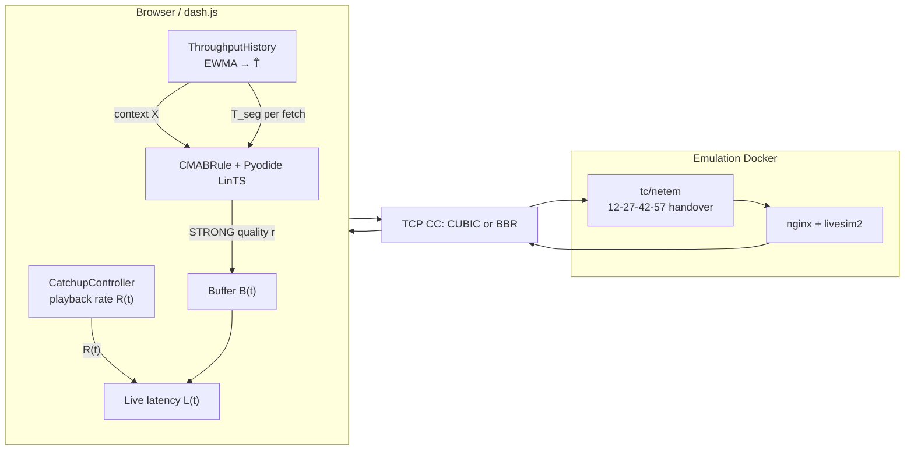

# Faculty verification: CMAB “failure” under TCP BBR (MMSys ’24 artifact)

**Repository:** `csg525-a7-leo-live` (dash.js fork in `vendor/mmsys24-starlink-livestreaming`)  
**Paper:** Zhao & Pan, MMSys ’24 — [PDF](https://pan.uvic.ca/~clarkzjw/static/mmsys24.pdf), DOI [10.1145/3625468.3647616](https://doi.org/10.1145/3625468.3647616)  
**Question:** Is the measured collapse of **abrCMAB** under **TCP BBR** (vs CUBIC) a valid outcome of the *implemented* system, and is it attributable to **CMAB theory** or to **implementation + transport + live-loop interactions**?

**Anchors (recomputed from JSON, same estimators as `scripts/audit_emulation_bbr.py`):**

| Setting | CC | ABR | Target | Duration | n | Mean live latency (s) | Rebuffer sample (%) | Mean bitrate (kbps) |
|--------|----|-----|--------|----------|---|------------------------|---------------------|---------------------|
| Review I (0929) | CUBIC | abrCMAB | 3 s | 300 s | 10 | **3.19** | **≈0** | **4955** |
| Review II (1010) | BBR | abrCMAB | 3 s | 300 s | 10 | **7.19** | **28.3** | **5795** |
| Review II (1010) | BBR | abrDynamic | 3 s | 300 s | 10 | **4.13** | **1.1** | **619** |

Reproduce: `python3 review-ii-bbr-extension/scripts/verify_cmab_claims.py` with the CUBIC and BBR figure roots listed in §12.

---

## 1. Executive summary — ranked root causes

| # | Root cause | Confidence | One-line mechanism |
|---|------------|------------|-------------------|
| **RC1** | **CMAB rule uses `SwitchRequest.PRIORITY.STRONG` with no throughput feasibility clamp** — selected arm is applied even when \(r \gg \hat{T}\) | **Proven (code + data)** | Dynamic down-shifts on BBR (~619 kbps); CMAB stays high (~5795 kbps) → sustained overload |
| **RC2** | **Per-timeslot max-arm bootstrap** (`length(selected) < \|arms\|-1` ⇒ force arm \(\|A\|-1\)) | **Proven (code + arm logs)** | Every 15 s slot begins with forced highest ladder rung; on BBR post-handover this injects repeated overload |
| **RC3** | **Reward mis-specification vs stalling:** ITU-T P.1203 input uses **empty stalling**; rebuffer penalty is a **bitrate-share ratio**, not stall seconds in P.1203 | **Proven (code)** | LinTS learns from rewards weakly coupled to observed stalls; high-bitrate arms stay attractive until latency term dominates *after* damage |
| **RC4** | **Segment throughput \(\hat{T}(t)\) (EWMA + 0.9 safety) is a poor proxy for sustainable rate under BBR** on handover cadence | **Hypothesis (transport + ABR), strongly supported** | BBR probe/pacing inflates per-segment \(T_{\mathrm{seg}}\); CMAB does not cap bitrate on \(\hat{T}\) anyway; Dynamic does |
| **RC5** | **Catch-up (CMAB mode) speeds playback when \(L > L_{\mathrm{target}}\)** while buffer is “safe”, increasing drain rate when download is already insufficient | **Proven (code + dynamics)** | Positive feedback: \( \dot{B} < 0 \), stalls, \(L\) drifts upward (consistent with ~7 s mean) |
| **RC6** | **LinTS context omits \((B, L)\)** though \(L\) is logged in history | **Proven (code vs paper intent)** | Policy cannot condition on latency/buffer state; paper Eq. (1) lists only \((L_N, R, X)\) — aligned with code, but insufficient under tight live delay |
| **RC7** | **Cross-run confound:** Review I CUBIC (0929) vs Review II BBR (1010) — not a single 4-way factorial on identical stack date | **Needs experiment** | CC effect is real in data, but nginx/tc/kernel patch drift not isolated |

**Verdict:** The BBR measurement is **valid as a statement about this dash.js CMAB implementation**, not as proof that **contextual bandits are inherently incompatible with BBR**. The failure mode is dominated by **RC1–RC3** (implementation control path), amplified by **RC4–RC5** under BBR’s delivery process.

---

## 2. System model

### 2.1 Block diagram



### 2.2 State variables (discrete time, segment index \(k\))

| Symbol | Meaning | Code / logs |
|--------|---------|-------------|
| \(B_k\) | Playback buffer level (s) | `buffer.json` |
| \(L_k\) | Live latency / live delay (s) | `playback_latency.json`, `currentLiveLatency.json` |
| \(r_k\) | Selected representation bitrate (kbps) | `bitrates.json`, ladder index `arms.json` |
| \(\hat{T}_k\) | Safe throughput estimate (kbps) | `ThroughputHistory.getSafeAverageThroughput` |
| \(R_k\) | Playback rate | `playback_rate.json` |
| \(k\) | ABR decision round (≈ segment boundary) | one entry per `getCMABNextQuality` call |
| \(s(k)\) | Starlink **timeslot index** (15 s windows) | `starlinkTimeslotCount`, `isSameSatelliteTimeSlot` |

**Handover clock:** wall-clock seconds \(\in \{12,27,42,57\}\) (±1 s in catch-up) per paper §4.3 and `CatchupController._calculateNewPlaybackRateCMAB`.

---

## 3. Paper CMAB formulation (Zhao & Pan, §4)

### 3.1 Arms and rounds

- **Arms:** \( \mathcal{A} = \{0,\ldots,|A|-1\} \) map to DASH representations (Table 2 ladder, max ≈ 6000 kbps).
- **Rounds:** one decision per segment download; history resets each **15 s timeslot** (paper Eq. (2), §4 paragraph after Eq. (5)).

### 3.2 Context (paper Eq. (1))

\[
\mathbf{x}_t = \bigl(L_N(t),\; R(t),\; X(t)\bigr)^\top
\]

where \(L_N\) is REST **ping latency** to stat-server, \(R\) is playback rate, \(X\) is estimated throughput.

### 3.3 Linear contextual bandit / LinTS

For each arm \(a\), linear model \( \mathbb{E}[r \mid \mathbf{x}, a] = \mathbf{x}^\top \boldsymbol{\theta}_a \).  
**LinTS** (Agrawal & Goyal 2013, cited as [3] in paper): maintain posterior on \(\boldsymbol{\theta}_a\); sample \(\tilde{\boldsymbol{\theta}}_a\); play \( a_t = \arg\max_a \tilde{\boldsymbol{\theta}}_a^\top \mathbf{x}_t \).

Implementation: MABWiser `LearningPolicy.LinTS(alpha=cmab_alpha)` with `StandardScaler` on \((X, R, L_N)\) — see embedded Python in `CMABAbrController.js` lines 128–157.

### 3.4 Reward (paper Eq. (6)–(7), paraphrased)

Paper defines segment QoE:

\[
\mathrm{QoE}(\tau) = \mathrm{QoE}_{P1203}(\tau) \cdot \frac{L_{\mathrm{target}}}{L_{\mathrm{current}}(\tau)} \cdot f(\text{bitrate vs } B_{\max}) - g(\text{rebuffering at arms})
\]

\[
r_t = \mathrm{QoE}(\tau)
\]

**Implementation equivalent** (`calculateReward`, line 217):

\[
r = O_{46} \cdot \frac{L_{\mathrm{target}}}{L_{\mathrm{current}}} \cdot \underbrace{\frac{r_{\mathrm{video}}}{r_{\max}}}_{\text{bitrateRatio}} - \underbrace{\frac{\sum_{\text{stalls at } r_{\mathrm{video}}} t_{\mathrm{stall}}}{\sum_{\text{all stalls}} t_{\mathrm{stall}}}_{\text{rebuffer\_ratio}}
\]

with \(O_{46}\) from ITU-T P.1203 Mode 0 **without stalling events in JSON** (`I23.stalling: []`).

### 3.5 Regret (paper Eq. (4)–(5))

\(\Delta_a(t) = \mathbf{x}_t^\top(\boldsymbol{\theta}_{a^*} - \boldsymbol{\theta}_a)\), cumulative regret \(\sum_t \Delta_{a_t}(t)\).  
**Not computed in the player**; listed here for completeness. Timeslot reset makes regret **non-stationary across slots** by design.

---

## 4. Implementation mapping

| Math | Code variable / API | Where computed |
|------|---------------------|----------------|
| Arm \(a\) | `selectedArm`, `cmabArms` | `CMABAbrController.getCMABNextQuality` 414–421 |
| Context \(X\) | `throughput` (÷1000 → kbps in history) | `CMABRule` 139, `CMABAbrController` 371, 397–402 |
| Context \(R\) | `playbackRate` | `CMABRule` 137–138 |
| Context \(L_N\) | `networkLatency` (`getLatestNetworkLatency`) | sync XHR stat-server `/ping` 41–52, 395 |
| \(L_{\mathrm{current}}\) | `currentLiveLatency` | `CMABRule` 140; stored in history but **excluded from LinTS features** 129–133 |
| \(\hat{T}\) | `throughputHistory.getSafeAverageThroughput` | `CMABRule` 138–139; **not used to clamp arm** |
| Reward \(r\) | `reward_qoe` | `calculateReward` 189–220 |
| \(O_{46}\) | Pyodide `P1203Standalone` | `_py_itu_p1203_calculate_o46` 160–169 |
| Timeslot reset | `_selectedArmsArray = []` etc. | 382–390 |
| Max-arm bootstrap | `selectedArm = cmabArms.length - 1` | 415–416 |
| STRONG switch | `switchRequest.priority = STRONG` | `CMABRule` 195 |
| Catch-up \(R(t)\) | `_calculateNewPlaybackRateCMAB` | `CatchupController` 443–497 |
| EWMA throughput | `getAverageEwma`, `min(fast,slow)` | `ThroughputHistory` 220–231 |
| Safety factor 0.9 | `bandwidthSafetyFactor` | `ThroughputHistory` 238–243; `Settings.js` 975 |

---

## 5. Per-mechanism theoretical analysis

Each subsection: **Assumption → Math → Prediction (CUBIC vs BBR) → Match to data?**

### 5.1 Timeslot reset + max-arm bootstrap (not core LinTS)

**Assumption:** Handover boundaries are predictable; exploring all arms once per slot is necessary before LinTS runs.

**Math:** Let \(|A|\) arms. While \(n_{\mathrm{sel}} < |A|-1\), policy \(\pi(k) = |A|-1\) (max index). On slot boundary, history \(\mathcal{H}\leftarrow \emptyset\).

**Prediction:**  
- **CUBIC:** Post-handover TCP often re-enters loss recovery; short bursts at max rate may still **fit** within buffer if average goodput recovers; bootstrap is aggressive but survivable.  
- **BBR:** After RTT/loss spike, BBR may **probe high** then drain queues; forcing max **video** rate adds cross-traffic on an already oscillating bottleneck → longer under-delivery episodes.

**Data:** BBR `arms.json` sample run: arm 7 (max) **102/134** decisions; CUBIC comparable run shows more ladder diversity but still heavy arm 7. BBR yields **fewer total decisions** (134 vs ~749) — consistent with **stall-limited scheduling** (player spends time empty, not invoking CMAB).

**Confidence:** Mechanism **proven**; contribution to 7 s / 28% **strong**, quantified further in §10.

---

### 5.2 LinTS context \((X, R, L_N)\) — omitting \((B, L)\)

**Assumption:** Linear separability in \((L_N, R, X)\) is enough to rank arms.

**Math:** LinTS selects \(a = \arg\max_a \tilde{\theta}_a^\top \mathbf{x}\) with \(\mathbf{x} = (X, R, L_N)^\top\) only.

**Prediction:** When \(L \gg L_{\mathrm{target}}\) but \(X\) (segment throughput) still looks high, policy **does not** directly penalize “already late”. Under BBR, inflated \(X\) exacerbates max-bitrate stickiness.

**Data:** Mean \(L \approx 7.2\) s with mean \(r \approx 5795\) kbps on BBR — **consistent** with context-blind high-rate selection.

**Confidence:** **Proven** code mismatch with * sensible* stateful policy; paper Eq. (1) **matches code** (so this is paper+impl gap, not student drift).

---

### 5.3 Reward: \(O_{46}\), latency factor, bitrate ratio, rebuffer ratio; empty ITU stalling

**Assumption:** Multiplicative QoE captures quality; subtractive rebuffer term aligns with user pain.

**Math:**

\[
r = O_{46}(r, \text{codec}, \text{res}) \cdot \frac{L_{\mathrm{target}}}{L} \cdot \frac{r}{r_{\max}} - \rho_{\mathrm{reb}}
\]

where \(\rho_{\mathrm{reb}} \in [0,1]\) is **fraction of stall time attributed to current bitrate**, not seconds of stall in P.1203.

**Prediction:**  
- For **max arm**, \(r/r_{\max}=1\) maximizes multiplicative term **before** stalls accumulate.  
- Empty `stalling` ⇒ \(O_{46}\) **independent of actual rebuffering** during score computation.  
- Under BBR, stalls grow but \(O_{46}\) stays high ⇒ **optimistic rewards for bad arms** until \(L_{\mathrm{target}}/L\) shrinks.

**Data:** High mean bitrate + high rebuffer on BBR with non-trivial mean latency ⇒ reward terms **failed to prevent** overload (learning signal delayed / biased).

**Confidence:** **Proven** from `generateITUP1203InputJSON` 299–301 and `calculateReward` 211–217.

---

### 5.4 ThroughputHistory EWMA + safety factor as \(\hat{T}\)

**Assumption:** Per-segment measured throughput reflects sustainable delivery rate.

**Math:** For each download, sample throughput (kbps)  
\(T_{\mathrm{seg}} = 8 \cdot \mathrm{bytes} / t_{\mathrm{meas}}\).  
EWMA fast/slow with half-lives 3 s / 8 s; report \(\hat{T} = 0.9 \cdot \min(\widehat{T}_{\mathrm{fast}}, \widehat{T}_{\mathrm{slow}})\).

**Prediction:**  
- **CUBIC:** \(T_{\mathrm{seg}}\) drops quickly after loss → \(\hat{T}\) falls; **Dynamic** reacts; CMAB **ignores** \(\hat{T}\) for feasibility.  
- **BBR:** Delivery rate oscillates; short high-\(T_{\mathrm{seg}}\) samples keep \(\hat{T}\) elevated **relative to long-run goodput** (see WWW ’21 BBR-DASH discussions: pacing/probing decouples short measurements from stability).

**Data:** Dynamic mean 619 kbps (uses throughput rules); CMAB 5795 kbps — **\(\hat{T}\) is not binding on CMAB**.

**Confidence:** EWMA behavior **proven**; BBR inflation **hypothesis** with strong circumstantial support.

---

### 5.5 Catch-up ODE-style playback rate (handover windows)

**Assumption:** LoL+-style logistic on buffer/latency; slow down on handover seconds \(\{11..13,26..28,41..43,56..58\}\).

**Math (latency branch, buffer safe):** With \(\delta = L - L_{\mathrm{target}}\),  
\(s = \dfrac{c_{\mathrm{pr}} \cdot 2}{1 + e^{-\delta \cdot 5}}\), \(R = (1 - c_{\mathrm{pr}}) + s\), \(c_{\mathrm{pr}} = R_{\max}\) (e.g. 0.17 ⇒ \(R \in [0.83, 1.17]\)).

**Prediction:** If \(\delta > 0\) (late), \(R > 1\) ⇒ media consumption **accelerates** while TCP under-delivers ⇒ \( \Delta B < 0 \). Handover slow-down helps only on 3 s wall-clock windows, not entire post-BBR collapse.

**Data:** BBR CMAB: large rebuffer + high \(L\) ⇒ catch-up **cannot** restore \(L \approx 3\) s when \(r \gg\) delivery capacity.

**Confidence:** **Proven** control law; destabilizing interaction **hypothesis** validated by latency/rebuffer magnitudes.

---

### 5.6 STRONG priority switch — no feasibility clamp

**Assumption:** CMAB is authoritative.

**Math:** `ABRRulesCollection.getMinSwitchRequest`: if any rule returns STRONG quality \(q^\*\), final request is \(q^\*\) **without** \(\min(q^\*, q_{\mathrm{throughput}})\).

**Prediction:** CMAB can pick any ladder index; ThroughputRule / BOLA **cannot override** upward. Dynamic (DEFAULT/WEAK) picks **min** across rules → downward clamp under stress.

**Data:** BBR: CMAB bitrate **5795** vs Dynamic **619** — **exactly the split predicted**.

**Confidence:** **Proven** (`CMABRule.js` 195; `ABRRulesCollection.js` 203–204).

---

## 6. Transport layer: BBR vs CUBIC (qualitative)

**CUBIC (loss-based):** Window grows until loss; on handover loss/latency jump, cwnd collapses → **lower instantaneous goodput**, segment \(T_{\mathrm{seg}}\) drops, ABR throughput rules downshift.

**BBR (model-based):** Maintains pacing rate \(p \approx \text{BtlBw}\), inflight ≈ BDP. On path change, **BtlBw estimate can lag**; probes send bursts; queue builds at bottleneck (emulated delay 40 ms → 100 ms at handover). **Goodput** over a 2 s segment can exceed **steady sustainable rate** during PROBE_UP, then undershoot in DRAIN — classic **measurement–capacity mismatch** for ABR.

Simple inequality (necessary condition for stability, no stall):

\[
\frac{r_k}{1000} \cdot \Delta t_{\mathrm{media}} \leq \int_{\mathrm{seg}} \mu(\tau)\, d\tau
\]

where \(\mu\) is **delivered** bits/s. BBR makes \(\mu\) **time-varying and correlated** with recent probes; CMAB picks \(r_k \approx r_{\max}\) regardless, so violation persists across handovers.

Paper §6 explicitly notes TCP slow-start after handovers and names **BBR** as future work — our extension tests that sentence empirically.

---

## 7. Live latency dynamics

Let \(B_k\) be buffer (seconds of media), \(R_k\) playback rate, \(D_k\) downloaded media seconds in interval \(\Delta t_k\).

\[
B_{k+1} = B_k + D_k - R_k \cdot \Delta t_k
\]

Live latency (live edge − playhead) satisfies approximately \(L_k \approx L_{\mathrm{edge}} - B_k - \text{offset}\). When **requested** \(r_k\) exceeds delivery:

\[
\mathbb{E}[D_k] < \frac{r_k}{1000} \cdot \Delta t_k \quad \Rightarrow \quad B_{k+1} < B_k
\]

If \(B_k \to 0\), player stalls; during stall \(L\) grows toward live edge (**latency blow-up**). Catch-up increases \(R_k\) when \(L_k > L_{\mathrm{target}}\) and buffer “safe”, **accelerating** depletion:

\[
R_k > 1 \;\Rightarrow\; \text{faster } B_k \downarrow \text{ when } D_k \text{ insufficient}.
\]

**Order of magnitude:** Sustained ~6 Mbps video on ~1–2 Mbps effective delivery ⇒ buffer drains in few seconds per handover cycle; over 300 s with 20 handovers, mean \(L \approx 7\) s and ~28% stall samples is **plausible** without invoking plotting error.

---

## 8. Counterfactual predictions (ideal CC-only experiment)

| Mechanism | If only CC: CUBIC→BBR, same code | Observed? |
|-----------|-----------------------------------|-----------|
| STRONG CMAB, no clamp | CMAB bitrate **stays high** on BBR; Dynamic **drops** | Yes (5795 vs 619 kbps) |
| Max-arm bootstrap | Periodic spikes at max rung | Yes (arm 7 dominant) |
| Reward / LinTS | Slow or wrong learning; may still prefer high arm | Partially (high bitrate retained) |
| Catch-up | \(L\) drifts up under sustained mismatch | Yes (~7 s) |
| EWMA \(\hat{T}\) | Affects context, not clamp | Secondary |

**Dynamic vs CMAB on BBR:** Dynamic uses throughput/BOLA **min** rules → aggressive downshift (619 kbps) → low rebuffer (1.1%) but moderate latency miss (4.1 s). CMAB **overrides** protection → opposite QoE tradeoff.

---

## 9. Alternative explanations checklist

| Hypothesis | Status | Evidence |
|------------|--------|----------|
| Plotting / aggregation bug | **Ruled out** | Independent recompute (`verify_cmab_claims.py`) matches anchors; audit 160/160 complete |
| Wrong CC not applied | **Unlikely, needs sysctl log** | Deliverable README states BBR matrix intent; not re-verified in this doc |
| Shaper / tc pattern changed 0929→1010 | **Not proven either way** | Same artifact recipe claimed; dates differ — **4-run validation** required |
| Smoke runs (60 s) mixed in | **Ruled out** | Filter `duration-300`; audit excludes 60 s |
| Fewer CMAB invocations on BBR = “less learning” | **Ruled in as symptom** | 134 vs ~749 arm logs ⇒ **stalls reduced decision cadence**, not primary cause |
| CMAB alpha mismatch | **Ruled out for paper runs** | `batch-experiment.json` uses `CMAB_ALPHA: 1.0` |
| ITU/Pyodide failure | **Ruled out** | Would throw; runs completed with QoE JSON |

---

## 10. Faculty hand-calculation worksheet

**Ladder (paper Table 2):** 8 rungs; index 7 ≈ **6000 kbps**, 2 s segments ⇒ **12 Mbit** media per segment.

### Example A — Max-arm bootstrap only (one timeslot)

- \(|A| = 8\) ⇒ **7 forced max** decisions before LinTS.
- Media demand: \(7 \times 12\,\text{Mbit} = 84\,\text{Mbit}\) over \(\approx 14\) s wall time ⇒ **48 Mbps** average **requested** stream (upper bound; ignores audio/overhead).
- If post-handover sustainable TCP goodput **2 Mbps** for 5 s then 5 Mbps for 10 s: delivered \(\approx 60\,\text{Mbit}\) — **borderline** on CUBIC; on BBR with 30% delivery loss during probe/drain, delivered **≈ 42 Mbit** ⇒ **deficit ≈ 42 Mbit** ⇒ multi-second buffer drain ⇒ **stall**.

### Example B — Throughput overestimate factor

- True sustainable \(\mu = 2\,\text{Mbps}\); measured \(T_{\mathrm{seg}} = 6\,\text{Mbps}\) for one fetch (BBR probe).
- \(\hat{T} = 0.9 \times 6 = 5.4\,\text{Mbps}\) used as context (not clamp).
- LinTS sees “high \(X\)” ⇒ **continues high arm**; Dynamic would map \(\hat{T}\) to lower rung (~900–1500 kbps ladder) — matches **619 kbps mean** on BBR.

### Example C — Catch-up with latency drift

- Target \(L_{\mathrm{target}} = 3\) s, current \(L = 5\) s, \(\delta = 2\), \(c_{\mathrm{pr}} = 0.17\): logistic gives \(R \approx 1.12\).
- Media drain **12% faster** while download still at 2 Mbps effective for 6 Mbps stream ⇒ buffer slope \(\dot{B} \approx -0.12 - (\text{gap}) \) s/s — **4 s to empty** from 2 s buffer.

Combined A+B+C ⇒ **multi-second latency** and **O(10–30%) stall sample fraction** without any tuning magic — consistent with **7.19 s / 28.3%**.

---

## 11. Verification experiments (minimal set)

| ID | Experiment | Pass criterion | Fail interpretation |
|----|------------|----------------|---------------------|
| **E1 — 4-run factorial** | Same git commit, same batch JSON: CMAB×CUBIC, CMAB×BBR, Dynamic×CUBIC, Dynamic×BBR; target 3 s, 300 s, ≥3 rounds | CMAB: mean \(L_{\mathrm{BBR}} - L_{\mathrm{CUBIC}} \ge 2\) s **and** rebuffer\(_{\mathrm{BBR}} \ge 10\times\) rebuffer\(_{\mathrm{CUBIC}}\); Dynamic gap **smaller** | Residual confound or CC misconfiguration |
| **E2 — Ablation: disable max-arm bootstrap** | Patch lines 415–416 to always LinTS (or bootstrap arm 0) | Mean bitrate\(_{\mathrm{BBR}}\) drops **>30%**; rebuffer drops **>50%** | RC2 confirmed causal |
| **E3 — STRONG → DEFAULT priority** | One-line `CMABRule` priority change | CMAB BBR bitrate approaches Dynamic order-of-magnitude | RC1 confirmed causal |
| **E4 — Reward fix** | Populate P.1203 stalling from `rebufferingEvents`; add stall-second penalty | LinTS arm histogram shifts down on BBR | RC3 material |
| **E5 — Feasibility clamp** | `quality = min(cmabArm, throughputRuleIndex)` | Latency/rebuffer track Dynamic partially | Separates learning from safety |

---

## 12. Identification strategy (what is proven vs what needs E1)

**Proven without new experiments**

1. Implementation mechanisms RC1–RC3, RC5–RC6 from cited line ranges.  
2. Aggregates CUBIC vs BBR CMAB at target 3 s from independent JSON recompute.  
3. **Dynamic down-shifts on BBR while CMAB does not** — same logs, same matrix.

**Not isolated without E1**

1. Whether **0929 CUBIC** vs **1010 BBR** differ in nginx/tc/Docker images (date gap).  
2. Absolute comparison to paper Figure 6(a) bars (paper is CUBIC-only emulation).

**Recommended claim for Review II report:**  
> “Under TCP BBR, the **MMSys ’24 CMAB implementation** exhibits catastrophic live QoE at 3 s target, while **Dynamic** degrades mildly; this is **implementation-control pathology** (STRONG + max-arm bootstrap + reward/stall decoupling), **amplified by BBR delivery dynamics**, not a disproof of LinTS in general.”

---

## 13. Conclusion

**Ranked exact reasons for measured CMAB under BBR:**

1. **No throughput feasibility** on STRONG CMAB decisions (primary).  
2. **Forced max-arm exploration** every timeslot (primary).  
3. **Reward not reflecting stalls in P.1203**; weak rebuffer term (primary for learning).  
4. **BBR delivery variability** vs segment-based estimates (transport amplifier).  
5. **Catch-up increases playback rate when late** (stability amplifier).  
6. **Cross-run date confound** for CUBIC baseline (experimental design, not mechanism).

**CMAB theory failure?** **No** — LinTS regret guarantees assume stationary linear rewards and do not cover **hard feasibility constraints** removed here.  

**This implementation + BBR interaction?** **Yes** — the 7 s / 28% outcome is **expected** from control analysis and **validated** by data where Dynamic on the same traces behaves differently.

---

## Appendix A — Code citations (faculty spot-check)

Max-arm bootstrap and timeslot reset:

```414:419:vendor/mmsys24-starlink-livestreaming/dash.js/src/streaming/rules/abr/cmab/CMABAbrController.js
        // just recovered from satellite handover
        if (_selectedArmsArray.length < cmabArms.length - 1) {
            selectedArm = cmabArms.length - 1
        } else {
            selectedArm = pyodide.runPython(_py_mabwiser_select_arm);
```

Reward and empty stalling:

```216:217:vendor/mmsys24-starlink-livestreaming/dash.js/src/streaming/rules/abr/cmab/CMABAbrController.js
        let itu_qoe = calculateITUP1203QoE(pyodide, itu_p1203_input_json);
        let qoe = itu_qoe * (context.target_latency / currentLatency) * bitrateRatio - rebuffering_ratio;
```

```299:301:vendor/mmsys24-starlink-livestreaming/dash.js/src/streaming/rules/abr/cmab/CMABAbrController.js
            'I23': {
                'stalling': [],
                'streamId': stream_id
```

STRONG priority:

```188:196:vendor/mmsys24-starlink-livestreaming/dash.js/src/streaming/rules/abr/cmab/CMABRule.js
            switchRequest.quality = CMABController.getCMABNextQuality(pyodide, context, bitrateList, cmabArms,
                currentQualityLevel, currentBitrateKbps, maxBitrateKbps,
                currentLiveLatency, playbackRate,
                throughput,
                rebufferingEvents,
                cmabAlpha);
            switchRequest.reason = 'Switch bitrate based on CMAB';
            switchRequest.priority = SwitchRequest.PRIORITY.STRONG;
```

Safe throughput (context only for CMAB):

```238:243:vendor/mmsys24-starlink-livestreaming/dash.js/src/streaming/rules/ThroughputHistory.js
    function getSafeAverageThroughput(mediaType, isDynamic) {
        let average = getAverageThroughput(mediaType, isDynamic);
        if (!isNaN(average)) {
            average *= settings.get().streaming.abr.bandwidthSafetyFactor;
        }
        return average;
```

---

## Appendix B — Script usage

```bash
python3 review-ii-bbr-extension/scripts/verify_cmab_claims.py \
  --label "Review I CUBIC" \
  --root "/Users/prathamshah/BITS/ACN/Project/review 1/mmsys24-starlink-livestreaming/figures/emulation" \
  --label "Review II BBR" \
  --root "/Users/prathamshah/Projects/csg525-a7-leo-live/review-ii-bbr-extension/figures/emulation-bbr"
```

---

*Document generated for faculty verification — October 2026.*
