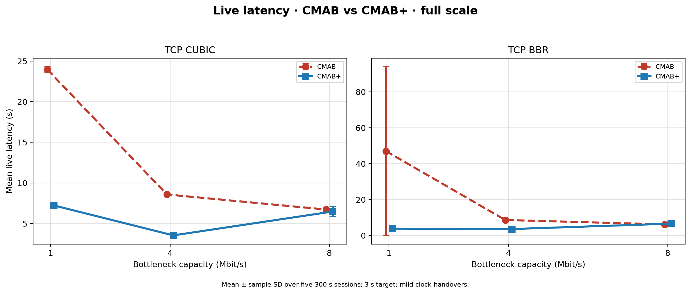
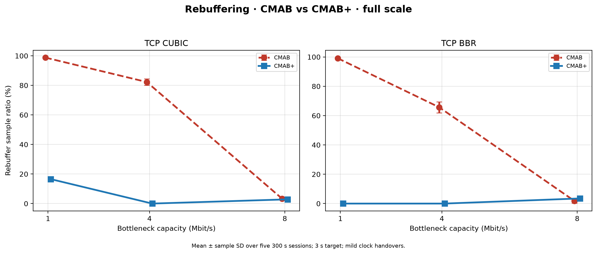
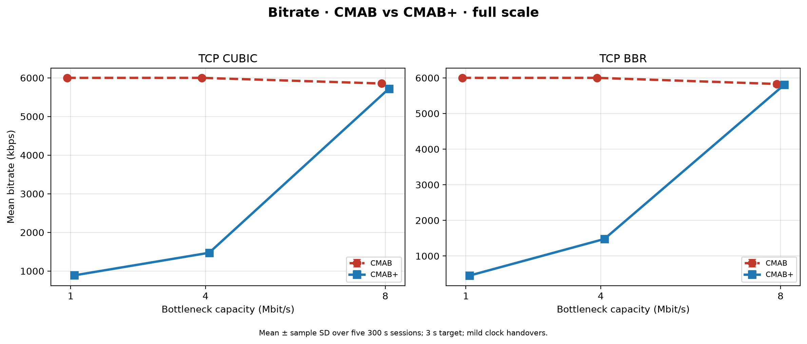

# Review III — CMAB+

This directory is the complete Review III record: failed designs, final code path,
raw experiment data, reproducible metrics, figures, conclusions, and the next
experiments.

## Final result

The defensible claim is narrow:

> When the bottleneck cannot carry the 6000 kbps top rung, old CMAB's forced
> top-rung bootstrap collapses. A throughput-feasible CMAB probe prevents that
> collapse. At 4 Mbit, CMAB+ reduces rebuffer from 65.69–82.25% to 0% and live
> latency from about 8.6 s to 3.54–3.62 s under both CUBIC and BBR.

CMAB+ does **not** generally beat L2A. At 4 Mbit it lands close to L2A:
CMAB+ is 3.54–3.62 s at about 1475 kbps; L2A is 3.36–3.40 s at 1500 kbps.
At 1 Mbit CUBIC, CMAB+ still rebuffers 16.54%, while L2A does not. At
8 Mbit, CMAB+ does not improve on old CMAB.

## Capacity decision, 3 s target, five 300 s sessions

| TCP | Capacity | Player | Latency | Rebuffer | Bitrate |
| --- | ---: | --- | ---: | ---: | ---: |
| CUBIC | 8 Mbit | old CMAB | 6.73 s | 3.31% | 5854 kbps |
| CUBIC | 8 Mbit | CMAB+ | 6.48 s | 2.85% | 5721 kbps |
| CUBIC | 8 Mbit | L2A | 5.15 s | 0.45% | 5075 kbps |
| CUBIC | 4 Mbit | old CMAB | 8.58 s | 82.25% | 6000 kbps |
| CUBIC | 4 Mbit | CMAB+ | 3.54 s | 0% | 1473 kbps |
| CUBIC | 4 Mbit | L2A | 3.36 s | 0% | 1500 kbps |
| CUBIC | 1 Mbit | old CMAB | 23.96 s | 98.79% | 6000 kbps |
| CUBIC | 1 Mbit | CMAB+ | 7.23 s | 16.54% | 888 kbps |
| CUBIC | 1 Mbit | L2A | 3.47 s | 0% | 450 kbps |
| BBR | 8 Mbit | old CMAB | 6.22 s | 1.77% | 5828 kbps |
| BBR | 8 Mbit | CMAB+ | 6.63 s | 3.49% | 5804 kbps |
| BBR | 8 Mbit | L2A | 4.32 s | 0% | 6000 kbps |
| BBR | 4 Mbit | old CMAB | 8.66 s | 65.69% | 6000 kbps |
| BBR | 4 Mbit | CMAB+ | 3.62 s | 0% | 1477 kbps |
| BBR | 4 Mbit | L2A | 3.40 s | 0% | 1500 kbps |
| BBR | 1 Mbit | old CMAB | 47.04 s | 99.13% | 6000 kbps |
| BBR | 1 Mbit | CMAB+ | 3.85 s | 0% | 450 kbps |
| BBR | 1 Mbit | L2A | 3.69 s | 0% | 450 kbps |

The 47.04 s BBR old-CMAB mean includes one 131.26 s session. The other four
sessions are 25.61–26.37 s; all five have about 99–100% rebuffer and request
6000 kbps, so the qualitative result does not depend on that outlier.

## Figures

The primary figures use the same error-bar line-chart structure as Review II.
Each metric has a CUBIC panel and a BBR panel. The two lines in a panel are
old CMAB (dashed red) and CMAB+ (solid blue). Capacity is on the horizontal
axis. Each metric has a full-scale and zoomed version.

- `figures/review2-style/latency_cmab_vs_cmabplus_full.png`
- `figures/review2-style/latency_cmab_vs_cmabplus_zoom.png`
- `figures/review2-style/rebuffer_cmab_vs_cmabplus_full.png`
- `figures/review2-style/rebuffer_cmab_vs_cmabplus_zoom.png`
- `figures/review2-style/bitrate_cmab_vs_cmabplus_full.png`
- `figures/review2-style/bitrate_cmab_vs_cmabplus_zoom.png`







The grouped bar charts and direct improvement chart remain under `figures/` as
secondary views.

## Clock non-regression (CUBIC + BBR done)

Paper clock, current CMAB+ code, targets 3/4/5/6 s, five rounds. Archives under
`data/archives/cmab-plus-clock-nonreg-{cubic,bbr}.tar.gz`. CMAB+ tracks old
CMAB on both CCs (BBR 3 s: 3.44 vs 3.45 s; CUBIC within ~0.15 s).

```bash
python3 review-3/analyze_clock_nonreg.py
```

Figures: `figures/clock-nonreg/` (CUBIC and BBR panels for latency, bitrate,
rebuffer).

## Trace validity with stall guard (CUBIC + BBR done)

Final CMAB+ player (rules 1–5). Targets 3/4/5/6 s, five rounds. Archive
`data/archives/cmab-plus-trace-stallguard-cubic-bbr-20261108.tar.gz`. At 3 s,
CMAB+ cuts CUBIC rebuffer ~81% → ~15% and BBR ~29% → ~8%; L2A remains near
0% at a few hundred kbps.

```bash
python3 review-3/analyze_trace_targets.py
```

Figures: `figures/trace-targets/`. Summary: `results/trace-targets-summary.md`.

## Files

- `ALGORITHM.md`: CMAB+ decision rules, with old CMAB as the contrast.
- `TRIALS.md`: complete design and experiment ledger, including failed trials.
- `METHOD.md`: exact matrix, shaper, code, and metric definitions.
- `PAPER_CLAIM.md`: research question, supported claim, and unsupported claims.
- `NEXT.md`: remaining experiments in execution order.
- `analyze_capacity.py`: regenerates every capacity CSV, table, and plot.
- `results/capacity-session-metrics.csv`: all 90 session-level measurements.
- `results/capacity-aggregate-metrics.csv`: 18 mean/SD/95% CI rows.
- `results/capacity-summary.md`: generated result table and interpretation.
- `data/capacity-{cubic,bbr}/`: extracted raw output for all 90 sessions.
- `data/archives/`: original downloaded tarballs with checksums in
  `DATA_MANIFEST.md`.
- `bbr-cmab-plus-*`: retained earlier BBR trial trees.

Regenerate the final capacity analysis from the repository root:

```bash
python3 review-3/analyze_capacity.py
```
